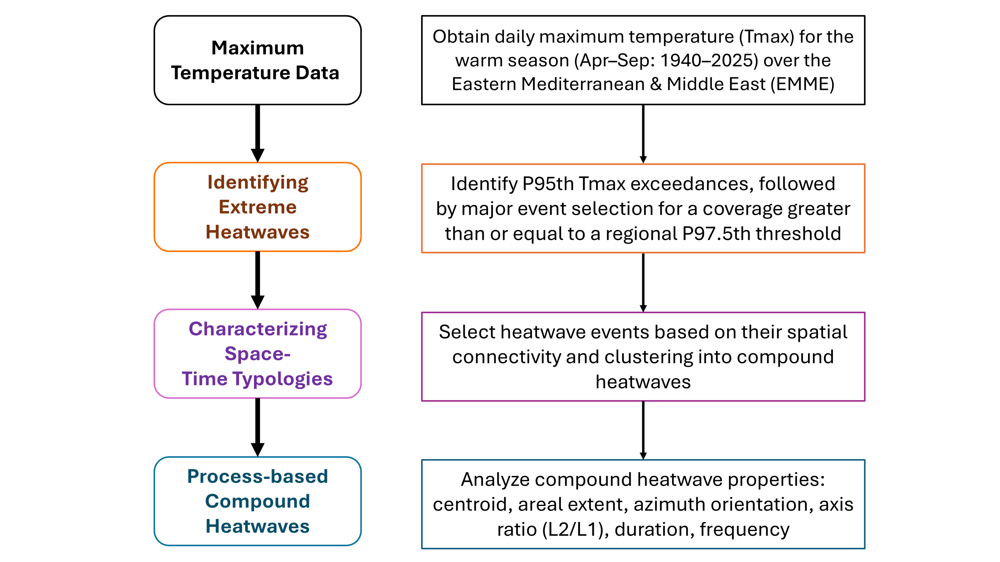

# SCORCH: Spatiotemporal Classification of Regional Compound Heatwaves

[](https://github.com/fawazbouhamad/compound-heatwave-typologies-SCORCH/actions/workflows/ci.yml)
[](LICENSE.txt)
[](docs/installation.md)
[](https://doi.org/10.5281/zenodo.21717874)

SCORCH finds **regionally extensive compound heatwaves** in gridded daily
maximum temperatures and sorts them into four types. It was written for the
study *Understanding Compound Space-Time Typologies of Large-Scale Extreme
Heatwaves* by **Fawaz Bouhamad and Nasser Najibi** (manuscript in
preparation), which applies it to the Eastern Mediterranean and Middle East
with ERA5 data for 1940-2025. This repository holds the software, a small
synthetic demo, tests, and the catalogs, tables and figures of the study.



## What SCORCH does

Starting from one NetCDF file of daily maximum temperature (Tmax) on a
regular grid, five stages run in order:

1. **Local heatwaves.** Each grid cell gets its own threshold (the 95th
   percentile of its warm-season Tmax). A local heatwave is a run of at
   least three days with at least three days at or above the threshold;
   single cooler days inside the run are bridged.
2. **Regionally extensive days.** Days on which the number of cells in a
   heatwave reaches the 97.5th percentile of the daily count are selected.
3. **Clusters.** On each selected day the heatwave cells are grouped with
   DBSCAN; the settings are chosen per day from a grid of candidates and
   pooled over consecutive selected days.
4. **Ellipses.** Each cluster gets a PCA ellipse (size, shape, orientation)
   and a temperature-weighted centroid.
5. **Compound events.** Consecutive selected days form one compound event,
   classified by how many clusters it has on each day:

| Type | Name | Rule |
|---|---|---|
| 1 | Widespread (Isolated) | one day with one cluster |
| 2 | Spatially Clustered | one day with two or more clusters |
| 3 | Temporally Clustered | several days, every day with one cluster or every day with several |
| 4 | Compound Clustering (Multi-Type) | several days mixing one-cluster and several-cluster days |

The outputs are five CSV catalogs (local heatwaves, selected days, clusters,
ellipses, compound events) and Table 1 (events by type). R scripts then fit
a power law to the largest ellipse areas and a log-Gaussian Cox process to
the centroid positions. [docs/usage.md](docs/usage.md) explains every rule;
[docs/io_reference.md](docs/io_reference.md) lists every file and column.

## Quick start

You need Python 3.11 or newer (R is only needed for the model scripts).

```bash
git clone https://github.com/fawazbouhamad/compound-heatwave-typologies-SCORCH.git
cd compound-heatwave-typologies-SCORCH
python -m venv .venv
# then activate it: .venv\Scripts\activate on Windows, source .venv/bin/activate elsewhere
python -m pip install -r requirements/core.txt -r requirements/figures.txt
python -m pip install -e .
scorch demo
```

`scorch demo` writes a small **synthetic** temperature dataset with six
designed heatwave events, runs the five stages on it in a few seconds and
reports what it found:

```
                       designed_event                    dates  expected_type  detected_type daily_cluster_counts  matches_design
                       Type 1 example               1991-07-10              1              1                    1            True
 Type 3 example (one cluster per day) 1991-08-12 to 1991-08-15              3              3              1-1-1-1            True
                       Type 2 example               1992-06-20              2              2                    2            True
                       Type 4 example 1992-08-03 to 1992-08-06              4              4              1-2-2-2            True
Type 3 example (two clusters per day) 1993-07-15 to 1993-07-17              3              3                2-2-2            True
              Type 4 example (longer) 1994-07-20 to 1994-07-25              4              4          1-1-2-2-2-1            True

compound events by type: {'1': 1, '2': 1, '3': 2, '4': 2}
```

It also draws this overview (the data are invented; the coordinates are not
a real place):


[docs/demo.md](docs/demo.md) walks through the demo and its files;
[docs/installation.md](docs/installation.md) covers the optional packages,
R, conda and the supported systems.

## Run SCORCH on your own data

Prepare a NetCDF file with `tmax(time, lat, lon)` in degrees Celsius for
every warm-season day of your period, a `maps/grid_cells.csv` for your grid
(`scorch.io.grid_cells_table` writes it), and a settings file with the
values that differ from the study (grid, years, months, thresholds):

```bash
scorch check-input my_data/tmax_processed.nc
scorch run --settings my_study.yml --input-dir my_data --supporting-input-dir my_data --output-dir my_results
```

All settings and their meaning are in
[config/manuscript_settings.yml](config/manuscript_settings.yml); the
scientific source files never need editing. Errors are explained in plain
language (a missing file, a wrong calendar, an unknown setting).

## Reproduce the study

1. Download `SCORCH_data.zip` from the Zenodo dataset record
   ([DOI 10.5281/zenodo.21717874](https://doi.org/10.5281/zenodo.21717874),
   version 1.0.0, MD5 `80772df9410306cbc419191d0dcb824c`), extract it and
   copy `scorch_data/tmax_processed.nc` to `input/tmax_processed.nc`
   (SHA-256 `fc080880b6f2065fb5eec9fe9dce71abdfdc44a72d1ae91e50abdd278fadaa90`).
2. Run `scorch check-input input/tmax_processed.nc --strict`, then
   `scorch run` (about three minutes). The five original scripts in
   `scripts/main_workflow/` give the same files.
3. For the models, figures and appendices follow the
   [reproduction guide](supporting_files/instructions/reproduction_guide.md).

The expected results, which the tests also check:

| Stage | Study result |
|---|---|
| 1 | 176,061 local heatwaves |
| 2 | 395 selected days (threshold 371 of 1,800 cells) |
| 3 and 4 | 753 clusters and ellipses |
| 5 | 51 compound events: 3 of Type 1, 3 of Type 2, 20 of Type 3, 25 of Type 4 |

On 11 October 2026 every catalog, Table 1, the supporting results, the
power-law fits, the LGCP parameters, the validation and the figures were
regenerated with this release and compared with the committed files: all
identical, apart from four figures whose headings need the Abadi font to
match pixel for pixel ([docs/reproduction_record.md](docs/reproduction_record.md)).

**Processed dataset.** `tmax_processed.nc` holds the daily maximum 2-m air
temperature of 1,800 one-degree cells (10-46 N, 20-70 E) on the 15,738
April-September days of 1940-2025, with no missing values. It was prepared
from hourly ERA5 (daily maximum of each UTC day at 0.25 degrees, then the
mean of the 16 points in each cell); that preprocessing was done outside this
repository and SCORCH starts from the prepared file.

## Repository map

```
src/scorch/            the package: settings, input reading, the five stages, demo, command line
scripts/               the manuscript scripts: stage wrappers, figures, R models, appendices
config/                manuscript_settings.yml, every study setting explained
demo/                  demo figure, expected demo results, optional R step
docs/                  installation, usage, I/O reference, demo, reproduction record, checklists
tests/                 pytest suite (plus tests/r for R)
requirements/          pinned Python packages of the verified run; environment/ holds the R lock file
input/                 put tmax_processed.nc here (not stored in Git)
output/                catalogs, Table 1 and figures of the study
supporting_files/      grid and map inputs, intermediate and model results, appendix and SI materials
```

## Tests and continuous integration

```bash
python -m pip install -r requirements/dev.txt
python -m pytest                      # unit tests and the demo end to end, about a minute
SCORCH_STUDY_INPUT=input/tmax_processed.nc python -m pytest   # adds the study regression test
Rscript --vanilla tests/r/test_r_functions.R                  # the R model functions
```

The tests cover threshold equality, bridged and split heatwaves, season
boundaries, the regional threshold, DBSCAN parameter counts and ties,
ellipse geometry, weighted centroids, event classification (including the
rejection of empty events and zero-cluster days), Table 1 with a missing
type, input errors, settings files, the command line and the demo. GitHub
Actions runs the installation and the tests on Ubuntu, Windows and macOS for
every change ([.github/workflows/ci.yml](.github/workflows/ci.yml)).

## Citation

Please cite the software release and, when you use the study results, the
dataset and the article. Citation metadata: [CITATION.cff](CITATION.cff)
(GitHub shows a "Cite this repository" button) and
[codemeta.json](codemeta.json).

- **Software:** Bouhamad, F., and Najibi, N. (2026). *SCORCH: Spatiotemporal
  Classification of Regional Compound Heatwaves* (version 1.0.0) [software].
  https://github.com/fawazbouhamad/compound-heatwave-typologies-SCORCH.
  A Zenodo software DOI will be added after the release is archived
  ([docs/release_checklist.md](docs/release_checklist.md)).
- **Dataset:** Bouhamad, F., and Najibi, N. (2026). *Processed ERA5 daily
  maximum temperature data for SCORCH, 1940-2025* (version 1.0.0) [dataset].
  Zenodo. https://doi.org/10.5281/zenodo.21717874
- **Article:** Bouhamad, F., and Najibi, N. *Understanding Compound
  Space-Time Typologies of Large-Scale Extreme Heatwaves*. Manuscript in
  preparation; use the published citation once available.

The software version (1.0.0 of this repository) and the dataset version
(1.0.0 of the Zenodo record) are separate things with separate identifiers.

## Licence

The code is licensed under [GPL-3.0-only](LICENSE.txt). Author-created
catalogs, tables, figures, figure sources and documentation are CC BY 4.0;
third-party data keep their own terms: the derived temperature results
contain modified Copernicus Climate Change Service information 2026 (ERA5,
[DOI 10.24381/cds.adbb2d47](https://doi.org/10.24381/cds.adbb2d47), under
the [Copernicus licence](https://ecds.ecmwf.int/licences/licence-to-use-copernicus-products);
neither the European Commission nor ECMWF is responsible for any use of
them), the Aswan station observations come from
[NOAA GHCN-Daily](https://doi.org/10.7289/V5D21VHZ), and the Natural Earth
map layers are public domain. Details, including the fonts and logos, are
in [LICENSE-DATA-AND-ARTWORK.md](LICENSE-DATA-AND-ARTWORK.md).

## Development notes

Version 1.0.0 packaged the research scripts of the study into the `scorch`
package without changing the method, the settings or the results
([CHANGELOG.md](CHANGELOG.md)). That packaging, the tests, the demo and the
documentation were prepared with the assistance of an AI coding tool
(Claude Code by Anthropic), operated and reviewed by Fawaz Bouhamad. The
scientific method and results are the authors' own and were verified against
the published outputs as recorded in
[docs/reproduction_record.md](docs/reproduction_record.md).
[CONTRIBUTING.md](CONTRIBUTING.md) explains how to set up a development
environment and what must stay stable.

## Issues and contact

- Problems installing or running SCORCH: open an issue in the
  [issue tracker](https://github.com/fawazbouhamad/compound-heatwave-typologies-SCORCH/issues).
- Scientific questions: contact Fawaz Bouhamad or
  [Nasser Najibi](https://nassernajibi.com/).

## Disclaimer

Use of the scripts, functions and documentation is at your own risk. These
materials are provided **as is**, without warranty of any kind. To the
extent permitted by applicable law, the authors and developers disclaim all
express or implied warranties, including merchantability and fitness for a
particular purpose. Unless required by applicable law or agreed to in
writing, the authors and developers shall not be liable for damages arising
from the use of, or inability to use, these materials, including loss of
data, damage to systems, or other direct, indirect, incidental or
consequential losses.

The views expressed in this repository and associated articles are those of
the authors and do not necessarily reflect the views of funding agencies,
affiliated universities or the U.S. Government. The authors may update this
disclaimer in future repository revisions. This notice does not change the
rights granted under the applicable licences.

---

<p align="center">
  <a href="https://nassernajibi.github.io/lab/"></a><a href="https://www.ufl.edu/"></a>
</p>
<p align="center">
  <a href="https://nassernajibi.github.io/lab/">Climate Resilience Lab</a><br>
  Department of Agricultural and Biological Engineering<br>
  University of Florida, Gainesville, Florida
</p>
