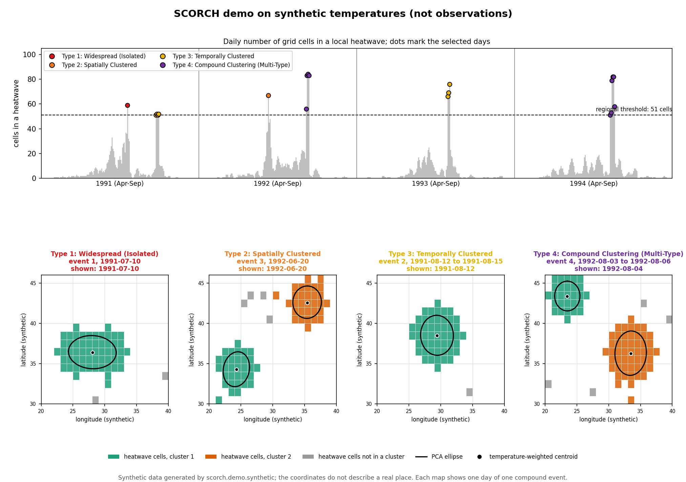

# The demo

`scorch demo` is a complete small example that runs in a few seconds and
needs no download, no PowerPoint and no special font. It is meant for a
first look at what SCORCH produces and for checking an installation.

**Everything in the demo is synthetic.** The temperatures are invented by
`src/scorch/demo/synthetic.py`: a gentle seasonal cycle, cooler cells to the
north, mild random weather noise, and six designed hot events (blobs of grid
cells warmed by 10 degC on chosen days). The coordinates do not describe a
real place. Nothing in the demo is a climate finding.

## Run it

```bash
scorch demo
```

Options: `--dir FOLDER` (default `demo/run`), `--seed N` (another weather
noise sample; the designed events stay), `--no-figure`, and `--with-r` to
also fit the power law of the manuscript to the demo ellipse areas with R
(needs `Rscript`; on Windows set `SCORCH_RSCRIPT` if it is not on the PATH).

## What you should see

The stages print their counts, then a table compares the designed events
with what SCORCH found:

```
                       designed_event                    dates  expected_type  detected_type daily_cluster_counts  matches_design
                       Type 1 example               1991-07-10              1              1                    1            True
 Type 3 example (one cluster per day) 1991-08-12 to 1991-08-15              3              3              1-1-1-1            True
                       Type 2 example               1992-06-20              2              2                    2            True
                       Type 4 example 1992-08-03 to 1992-08-06              4              4              1-2-2-2            True
Type 3 example (two clusters per day) 1993-07-15 to 1993-07-17              3              3                2-2-2            True
              Type 4 example (longer) 1994-07-20 to 1994-07-25              4              4          1-1-2-2-2-1            True

compound events by type: {'1': 1, '2': 1, '3': 2, '4': 2}
```

With the recorded seed the demo selects 19 days (regional threshold 51 of
320 cells) and finds exactly the six designed events: one of Type 1, one of
Type 2, two of Type 3 and two of Type 4. `demo/expected_results.json`
records these numbers and `tests/test_demo.py` checks them.

The figure `demo/run/output/figures/demo_overview.png` (a copy made with the
recorded seed is kept as `demo/demo_overview.png`) shows the daily number of
heatwave cells with the selected days coloured by event type, and one day of
one event of each type with its heatwave cells, clusters, ellipses and
temperature-weighted centroids:



## How to read the results

- **Type 1** (10 July 1991): two overlapping warm blobs on one day form a
  single connected cluster; the day before and after only one blob is hot,
  so the cell count stays below the threshold and the event is one day long.
- **Type 2** (20 June 1992): the same idea with the blobs far apart: two
  clusters on one day.
- **Type 3**: one blob hot for four consecutive days (one cluster every day),
  and two distant blobs hot on the same three days (two clusters every day).
- **Type 4**: a blob hot for several days joined by a distant second blob
  on some of them, so the daily cluster counts mix 1 and 2.

`summary.md` in the demo folder repeats this explanation with the detected
events and Table 1 of the demo; `settings.yml` records the settings that
differ from the manuscript (the synthetic grid and period, and the Section 4
statistics switched off) so the run can be repeated with `scorch run`.

## Files written

```
demo/run/
  input/tmax_processed.nc            synthetic temperatures (NetCDF, same layout as the study file)
  input/maps/grid_cells.csv          the demo grid
  settings.yml                       the demo settings
  output/catalogs/01..05_*/          the five catalogs
  output/tables/table_1.csv          compound events by type
  output/supporting_results/         thresholds, daily summary, DBSCAN searches, ...
  output/figures/demo_overview.png   the figure (needs matplotlib)
  output/run_records/                checksums of what each stage read and wrote
  summary.md                         the summary
```

The demo folder is ignored by Git. The LGCP model is not part of the demo:
with only a few dozen synthetic centroids its fit would not mean anything;
the study's model runs are described in
[reproduction_record.md](reproduction_record.md).
